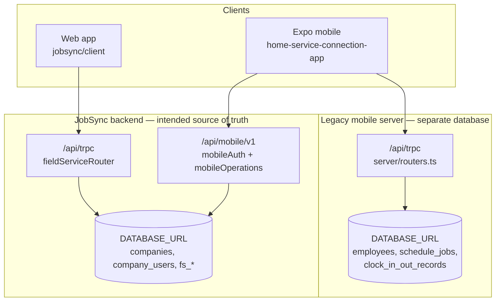

# HSC System Architecture Audit

Audit date: 2026-10-17. Method: source inspection of both repositories in this workspace. No production database, payment, invoice, payroll, or migration was read or changed. No live customer session was used.

Runtime status: **not executed** against production or staging. `DATABASE_URL` is not present in this workspace. There are no `.env` files in either repository checkout. Findings below are **confirmed in source** unless marked **suspected** or **not verified**.

## Verdict

Home Service Connected is **two deployable backends and two MySQL databases**, with the mobile app acting as a hybrid client.

For a Company user, identity, jobs, payments, and clock records are **intended** to live in the JobSync backend (`repos/jobsync`). The mobile app reaches that backend over HTTPS at `/api/mobile/v1`. The web app reaches the same backend over cookie-authenticated tRPC at `/api/trpc`.

The Expo repository (`repos/home-service-connection-app`) still ships **its own Express/tRPC server and its own MySQL schema** (Luxury Wash / detailer era). Company mode disables many of those calls, but the legacy server, schema, and several hardcoded hosts remain. That legacy database has **no `company_id` column**.

The preferred shape already exists for Company data. The repair is to stop the mobile UI from recomputing or reading the legacy plane, not to build a third backend.

## Repository map

| Piece | Repository | What it is |
|---|---|---|
| Web application | `repos/jobsync` | React 19 + Vite + Wouter. Package name `luxurywashonwheels-app`. Pages under `client/src/pages`. Portal shell `client/src/pages/FieldServiceApp.tsx`. |
| Web and mobile API | `repos/jobsync/server` | Express. tRPC mounted at `/api/trpc` from `server/fieldServiceRouter.ts`. Mobile REST from `server/mobileAuth.ts` and `server/mobileOperations.ts`, registered in `server/index.ts`. |
| Authoritative Company database | JobSync MySQL via `DATABASE_URL` | Raw SQL (`mysql2`). Drizzle is a dependency but **no Drizzle schema is used**. DDL lives in `migrations/*.sql`. Pool timezone is `Z` (`server/db.ts`). |
| Mobile application | `repos/home-service-connection-app` | Expo Router 57 / React Native. Company traffic goes through `lib/jobsync-mobile-api.ts`. Legacy traffic goes through `lib/trpc.ts`. |
| Legacy mobile backend | `repos/home-service-connection-app/server` | Express + tRPC + Drizzle (`drizzle/schema.ts`). **Does not proxy JobSync.** No `companyId` on local tables. |
| This audit | `docs/HSC_*.md` in the mobile repository | Documentation only. |

## Which backend each client uses

| Client | Transport | Default or build host | Database |
|---|---|---|---|
| Web | Cookie `hsc_company_session` + `/api/trpc` | Same origin as the web deployment. Production host **not verified** in this workspace. | JobSync `DATABASE_URL` |
| Mobile, Company mode | Bearer JWT + `/api/mobile/v1/*` | `resolveJobSyncBaseUrl()` in `lib/jobsync-mobile-api.ts`. Unset or disallowed hosts fall back to `https://www.homeserviceconnected.com`. Production EAS env sets `EXPO_PUBLIC_JOBSYNC_API_BASE_URL` to `https://jobwash-veysiubh.manus.space` (`eas.json`). Both hosts are on the allowlist. | JobSync `DATABASE_URL` **if that host is the current web deployment**. Whether those two hosts share one database is **not verified**. |
| Mobile, legacy mode | tRPC `${getApiBaseUrl()}/api/trpc` | `EXPO_PUBLIC_API_BASE_URL`, else Metro host port 3000, else relative URL. `EXPO_PUBLIC_API_URL` falls back to `http://127.0.0.1:3000` in `app/_layout.tsx`. | Legacy MySQL |
| Mobile schedule leftovers | `fetch` to hardcoded `APP_API_BASE` | `https://luxwashapp-n2wveyqg.manus.space` in `app/(tabs)/schedule.tsx` and `components/add-job-modal.tsx` | Legacy deployment, **not** the JobSync allowlist. `resolveJobSyncBaseUrl` deliberately rejects this host. |

A single mobile build can therefore talk to **three** hosts: the JobSync base URL, the legacy tRPC base URL, and the hardcoded Luxury Wash host.

## Authentication

| Actor | Store | Web | Mobile |
|---|---|---|---|
| Company user | `company_users` + `companies` | `auth.emailLogin` / `auth.pinLogin`. JWT cookie. `getCompanySession` reloads the row and requires `id`, `company_id`, `is_active`, and the live role. | `POST /api/mobile/v1/auth/login`. Bearer stored in SecureStore key `hsc_jobsync_mobile_bearer_v1`. `requireMobileCompany` takes `companyId` from the token only, then reloads membership. Token lifetime is 30 days (`MOBILE_TOKEN_SECONDS`). |
| Platform operator | `platform_operators` | Platform tRPC | `loginPlatform` exists in `lib/jobsync-auth-context.tsx`. A dedicated platform login screen was **not found**. |
| Legacy detailer | `employees` PIN | Not the web portal | `employee.login` still exists on the legacy server. The Expo login screen uses Company email/password, not PIN. |
| Customer portal | `customers` / `customer_sessions` on the **legacy** DB | Not the JobSync customer table `fs_customers` | `lib/customer-context.tsx` |
| Investor | `investors` on the **legacy** DB | Not found as a JobSync tenant feature | `lib/investor-auth.tsx` |
| Manus OAuth user | legacy `users` | Not the Company session | `constants/oauth.ts`, SecureStore `app_session_token` |

Company mode bridges a JobSync user into the old tab shell as a synthetic employee id `jobsync-{companyId}-{userId}` (`lib/jobsync-role-map.ts`). That string is **not** a `company_users.id` and **not** an `employees.employee_id`. It must not be written to the legacy clock or location tables as if it were a shared key.

## Duplicated business logic

The same words are calculated in more than one place:

| Metric | Authoritative JobSync definition | Second calculation |
|---|---|---|
| Booked revenue | `dashboard.summary` sums `fs_jobs.amount` where `status <> 'cancelled'`, by `scheduled_start_at` in the company timezone | Mobile Operations Overview sums a client-side formula over a filtered job list. `getMobileFinanceSummary` sets `bookedRevenue` to all-time `billedTotal`. `GET /api/mobile/v1/reports/summary` sums completed `amount` with **no date filter**. |
| Collected revenue | `getDashboardPaymentProjection` | `getJobInvoiceSummary` / `getCompanyNetPaymentProjection` (company-wide, not the dashboard period) |
| Clock time | `fs_clock_records` via `timeClockService` | Legacy `clock_in_out_records` via `timesheet.clockIn` when Company authority is off |
| Live location | `fs_technician_locations` | Legacy `detailer_locations` |

Company timekeeping is guarded so a Company session does not fall through to the legacy ledger (`COMPANY_TIMEKEEPING_LEGACY_FALLTHROUGH_BLOCKED` in `lib/jobsync-company-authority.ts`). That guard is necessary because the second ledger still exists.

## API versions

There is one mobile contract: `/api/mobile/v1`. Duplicate mounts exist for the same handlers (`/company/jobs` and `/jobs`, `/schedule`). Web uses tRPC procedures, not that REST surface. Legacy mobile tRPC is a **different API** on a different server, not a version of `/api/mobile/v1`.

Unmounted legacy routers under `jobsync/server/routers/` (`stripePayments`, `upsells`, `inspections`, and others) still contain an older `payments` table with `tip`. They are **not** on `appRouter`. They are not the live web path. They are a trap if someone remounts them.

## Identity model

| ID | JobSync | Legacy mobile DB |
|---|---|---|
| Company | numeric `companies.id` | none |
| Employee / member | numeric `company_users.id`, optional string `member_id` | string `employees.employee_id` |
| Customer | numeric `fs_customers.id` | string `customers.customer_id` |
| Job | numeric `fs_jobs.id` | string `schedule_jobs.job_id` |
| Clock row | numeric `fs_clock_records.id` | string `clock_in_out_records.record_id` |

There is no mapping table between these identifiers.

## Caches

Mobile Company sync (`lib/jobsync-sync-context.tsx`) polls `GET /api/mobile/v1/sync` on an interval, on foreground, and on reconnect. It bumps a revision counter. It is **not** an offline write queue.

Legacy schedule screens persist jobs in AsyncStorage (`tlw_schedule_jobs_v9_*`). There is no SQLite database. There is no offline queue for clock-in, payments, or job creates.

Web uses React Query. Default `staleTime` is 30 seconds. Dashboard polls every 60 seconds. Dispatch polls about every 30 seconds. No WebSocket or SSE server was found for operational data.

## Third parties

Configured by environment variable name only. Values were **not** available here, so connectivity is **not verified**.

| Integration | Where | Env names |
|---|---|---|
| MySQL | both servers | `DATABASE_URL` (separate deployments) |
| Sessions | JobSync | `JWT_SECRET` |
| Stripe Connect and SaaS billing | JobSync | `STRIPE_SECRET_KEY`, `STRIPE_WEBHOOK_SECRET` |
| Email | JobSync Resend | `RESEND_API_KEY`, `RESEND_FROM_EMAIL`, `RESEND_WEBHOOK_SECRET` |
| SMS and voice | JobSync Twilio | `TWILIO_ACCOUNT_SID`, `TWILIO_AUTH_TOKEN`, `TWILIO_API_KEY`, `TWILIO_API_SECRET`, `TWILIO_TWIML_APP_SID` |
| Object storage and maps proxy | Forge | `BUILT_IN_FORGE_API_URL`, `BUILT_IN_FORGE_API_KEY`, `VITE_FRONTEND_FORGE_API_URL`, `VITE_FRONTEND_FORGE_API_KEY` |
| Legacy Stripe / maps | Expo app | `EXPO_PUBLIC_STRIPE_PUBLISHABLE_KEY`, `EXPO_PUBLIC_GOOGLE_MAPS_API_KEY` |

## What is already the right architecture

Company records already have one owner: JobSync services (`jobService`, `paymentService`, `financeService`, `timeClockService`, `dispatchService`, `customerService`) backed by `fs_*` tables scoped with `company_id`. Web and mobile are two transports. Preserve that. Do not add a second revenue formula or a second timesheet table.

## Inspection summary

Counted from `HSC_WEB_MOBILE_FEATURE_MATRIX.md`:

| | Count |
|---|---|
| Features inspected | 48 |
| Fully connected | 1 |
| Partially connected | 25 |
| Disconnected | 9 |
| Not verified | 13 |
| Confirmed critical code defects | 8 |
| Shared root causes | 6 |

These counts are source classifications. They are not production pass/fail results.
