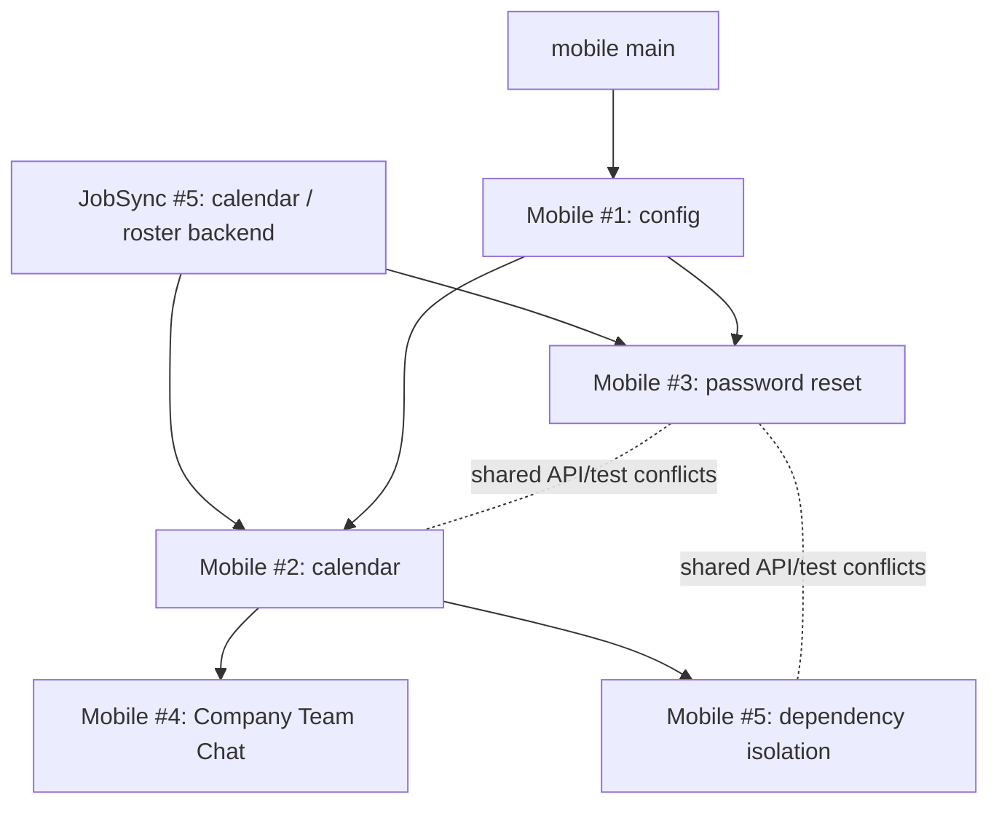

# Final Pre-Merge Reconciliation Audit

**Scope:** `Luxurywashent/jobsync` PR #5 and `Luxurywashent/home-service-connection-app` PRs #1–#5.

**Audit mode:** Read-only. No PR was merged, no code or production configuration was changed, and no deployment, publication, rebase, squash, force-push, or Phase 2 activity was performed.

**Audit conclusion:** **Do not authorize a merge yet.** The stack has a sound Company-authentication direction, but two real stacked-branch conflicts, live legacy Luxury Wash runtime paths, a missing deployed Company Jobs endpoint, non-green validation, and unverified backend PR access must be resolved first.

## Executive Decision

The five mobile PRs have the requested branch bases and are currently marked clean by GitHub, but “clean” is not sufficient evidence that their combined architecture is safe. The mobile reconciliation stack contains two actual merge conflicts when sibling work is composed, and the resulting app still retains direct legacy production calls outside the new Company API adapter. The deployed HSC/JobSync API also returns `404` for the Company Jobs route consumed by the Calendar branch.

> **Merge status: BLOCKED.** Do not merge any of the six PRs until the blockers in this report are cleared and the combined stack is retested against the deployed Company API.

## Pull Request Inventory and Base Validation

| Repository / PR | Head → Base | Metadata validation | Audit result | Merge disposition |
|---|---|---|---|---|
| JobSync [#5][1] | `reconcile/manus-calendar-roster` → `main` | The requested head/base were available in the read-only reconciliation evidence. Direct GitHub retrieval was unavailable to this session. | Adds Company calendar/roster backend work and removes the `LW_DATABASE_URL` fallback according to the supplied branch audit. | **Block pending direct backend review, deployment/config verification, and authenticated endpoint evidence.** |
| Mobile [#1][2] | `reconcile/mobile-config` → `main` | Verified from GitHub metadata; GitHub says clean. | HSC bundle ID, slug, and SDK-alignment work are correctly targeted. | **Hold** until global blockers are resolved. |
| Mobile [#2][3] | `reconcile/mobile-calendar` → `reconcile/mobile-config` | Verified from GitHub metadata; GitHub says clean. | Adds Company roster/sync/full-day calendar behavior, but depends on the unavailable deployed Company Jobs endpoint and retains legacy Admin Schedule paths. | **Block.** |
| Mobile [#3][4] | `reconcile/mobile-password-reset` → `reconcile/mobile-config` | Verified from GitHub metadata; GitHub says clean. | Uses `accountType: "company"` and generic reset success messaging. It conflicts with calendar/isolation changes in shared API and test files. | **Block until stacked conflict is reconciled and backend reset route is live.** |
| Mobile [#4][5] | `reconcile/mobile-company-chat` → `reconcile/mobile-calendar` | Verified from GitHub metadata; GitHub says clean. | Company-scoped Community, Groups, and Direct Messages. | **Hold**; no direct sibling conflict with dependency isolation was found. |
| Mobile [#5][6] | `reconcile/mobile-dependency-isolation` → `reconcile/mobile-calendar` | Verified from GitHub metadata; GitHub says clean. | Canonicalizes the Company API adapter toward HSC, but collides with password-reset changes and leaves legacy non-Company/runtime paths. | **Block until conflict and remaining legacy-call remediation are complete.** |

The five mobile commits have **zero GitHub check runs**, so there is no hosted CI evidence to substitute for the local audit. The JobSync PR’s direct check status could not be retrieved because the current task credential did not have read access to that private repository.

## Dependency Graph and Correct Merge Order

The graph is **not currently mergeable as a safe linear stack**. In-memory merge simulations found the following actual conflict pairs:

| Composition | Shared files requiring resolution | Consequence |
|---|---|---|
| Calendar #2 + Password Reset #3 | `lib/jobsync-mobile-api.ts`, `tests/jobsync-mobile-api.test.ts` | The conflict must retain both `COMPANY_SYNC_PATH` / `COMPANY_JOBS_PATH` and the password-reset path/payload/tests. |
| Password Reset #3 + Dependency Isolation #5 | `lib/jobsync-mobile-api.ts`, `tests/jobsync-mobile-api.test.ts` | The conflict must retain Company reset support, canonical origin validation, sync/jobs helpers, and all regression tests. |
| Company Chat #4 + Dependency Isolation #5 | None found in simulation | These sibling changes auto-compose after the parent calendar branch is safely integrated. |

### Recommended Sequence — After Blockers Are Fixed

1. **Validate and merge JobSync #5 first**, only after confirming `DATABASE_URL` is configured in the target runtime and the Company Jobs and password-reset contracts are deployed and tenant-scoped.
2. **Merge Mobile #1** after its SDK patch versions are aligned and a fresh Expo diagnostic passes.
3. **Retarget Password Reset #3 to the Calendar foundation and resolve the two shared-file conflicts explicitly.** This is an integration action, not a Phase 2 feature. Do not rebase or squash; use the approved repository workflow to update the PR base and make one reviewed conflict-resolution commit.
4. **Merge Calendar #2**, then the reconciled Password Reset #3.
5. **Update Team Chat #4’s base to `main`** after Calendar merges, verify its Company chat endpoint acceptance tests, then merge it.
6. **Update Dependency Isolation #5’s base to the post-password-reset `main`**, resolve its `lib/jobsync-mobile-api.ts` and `tests/jobsync-mobile-api.test.ts` conflict, re-run the full Company contract suite, then merge it last.

After each parent merge, edit the child PR’s **base branch** in GitHub and re-run the combined checks. Do not leave a child PR based on a deleted or already-merged parent branch. The base update must be followed by a fresh conflict check; GitHub’s “able to merge” indicator is not a replacement for this validation.

## HSC / JobSync Contract and Tenant-Isolation Audit

### Safely Migrated

| Area | Evidence | Assessment |
|---|---|---|
| Company mobile authentication | The mobile adapter sends bearer tokens, normalizes Company sessions, and rejects profiles without a Company boundary. | **Pass.** |
| Company roster isolation | `normalizeJobSyncCompanyRoster(payload, expectedCompanyId)` rejects a mismatched Company ID before UI use. | **Pass.** |
| Backend tenant model | The JobSync reference router signs a tenant token containing `companyId`; session validation reloads an active user by both `id` and `company_id`, and Company data queries use `company_id = ?`. | **Pass in reference source; PR #5 must still be inspected directly before approval.** |
| Company Price Book reading | The Company service picker preserves web service IDs and filters inactive services. | **Pass for read path.** |
| Password-reset privacy | Mobile reset payload includes `accountType: "company"`; UI uses a generic success message rather than exposing account existence. | **Pass in mobile branch.** |
| Mobile branding | Resolved Expo configuration is `Home Service Connection`, slug `home-service-connection`, scheme `homeserviceconnection`, and iOS/Android package `com.homeserviceconnection.mobile`. | **Pass.** |

### Unresolved Contract Requirements

| Contract | Audit evidence | Required resolution |
|---|---|---|
| Company Jobs read API | Both `https://www.homeserviceconnected.com` and `https://jobwash-veysiubh.manus.space` returned `404` for `GET /api/mobile/v1/company/jobs` with an invalid bearer token. Calendar #2 invokes this route. | Deploy/verify the JobSync #5 route, then test with an authenticated Company account and confirm company-only rows, date filtering, roster assignment, and 401/403 cross-tenant rejection. |
| Company job write API | `components/add-job-modal.tsx` still saves through local `jobs.upsert` / `jobs.createRecurring`, not a Company Jobs mobile endpoint. | Publish an authoritative Company job-create/update API that validates `priceBookItemId`, Company scope, assignee membership, and totals server-side. Do not replace the current local calls until equivalent HSC contracts are verified. |
| Password reset backend | The mobile request is implemented, but live email delivery and the website reset page were not safely exercised because a real request sends email. | Validate JobSync #5’s request and reset routes in a controlled test account, including one-time token hashing, expiry, use-once behavior, rate limits, generic responses, and web/mobile sign-in after reset. |
| Team Chat parity | Mobile Community/Group/Direct APIs have contract tests, while the local web reference still exposes legacy fixed Team Chat behavior. | Verify the deployed backend route set with two Company users, including tenant isolation, role checks, group archive/edit, direct thread scope, and notification/revision behavior. |

## Remaining Luxury Wash Dependencies

### Intentionally Retained

| Exact path | Finding | Classification |
|---|---|---|
| `eas.json` → `submit.production.ios.appleId` | `adrian@luxurywashonwheels.com` is an App Store Connect account identifier, not an application API dependency. | **Intentionally retained operational identity.** |
| `lib/jobsync-mobile-api.ts` → `HSC_API_HOSTS` | `jobwash-veysiubh.manus.space` remains an allowlisted JobSync deployment alias. Its invalid-token responses matched the HSC domain during this audit. | **Transitional HSC/JobSync alias; restrict or remove after canonical-domain parity is confirmed.** |
| `components/add-job-modal.tsx` | Legacy packages/detailers and direct `APP_API_BASE` fallback remain for non-Company sessions; Company sessions use the HSC Price Book and roster path. | **Intentionally retained legacy-session behavior, but should be isolated or removed if this app will become Company-only.** |

### Safely Migrated

| Exact path | Finding | Classification |
|---|---|---|
| `lib/jobsync-mobile-api.ts` in Dependency Isolation #5 | Default Company origin becomes `https://www.homeserviceconnected.com`; non-allowlisted environment overrides fall back to that origin. | **Safely migrated, subject to endpoint parity validation.** |
| JobSync #5 `server/db.ts` | Read-only branch audit reports removal of the `LW_DATABASE_URL` fallback. | **Safely migrated, but block until target `DATABASE_URL` is verified.** |
| `app.config.ts` in Config #1 | HSC bundle/package identifiers are retained. | **Safely migrated.** |

### Dangerous / Must Block Merge

| Exact path | Finding | Why this blocks merge |
|---|---|---|
| `eas.json` → `build.production.env.EXPO_PUBLIC_API_BASE_URL` | Points to `https://luxwashapp-eysenspg.manus.space`. | A store build can still inject a legacy Luxury Wash production origin into runtime code. Replace only after mapping every consumer to an HSC equivalent. |
| `app/(tabs)/admin-schedule.tsx:47, 894, 916, 935, 1837, 2225, 4789` | Direct `https://luxwashapp-n2wveyqg.manus.space` calls for private notes, booking lookup, customer history, and invoices. These calls do not use the Company bearer adapter or a Company ID. | Company users can reach Admin Schedule flows; the actions can send Company data to the legacy host or fail silently. Do not merge as HSC-only reconciliation. |
| `app/(tabs)/schedule.tsx:479, 2111, 2133, 2153, 3093, 3095, 3250, 3516, 3788` | Direct legacy host calls for private notes, availability/listing, booking lookup, customer history, and performance. | The alternate schedule keeps active legacy production dependencies outside the Company API boundary. |
| `app/(tabs)/admin-receptionist.tsx:235, 556, 571` | Runtime and displayed webhook URL use the legacy host. | This is a visible production configuration dependency and must be migrated or explicitly excluded from HSC Company access. |
| `server/invoiceRouter.ts:339`, `server/receptionistRouter.ts:703, 768`, `server/routers.ts:5508, 5582, 5806, 8309, 9251, 10741` | The mobile repository’s bundled server continues to contain Luxury Wash public URLs, reset-link defaults, invoice/receptionist host references, and marketing workflows. | The HSC app cannot be certified as free of Luxury Wash production dependencies while these server runtime paths remain. |

The audit found no committed secret value in source. The Google Maps key in `eas.json` is intentionally public by Expo naming convention, but it should be platform-restricted before a store release. `DATABASE_URL` is a necessary generic runtime variable, not itself a Luxury Wash dependency.

## Validation Results

| Validation | Result | Notes |
|---|---|---|
| Final dependency-isolation branch TypeScript | **Pass** | `tsc --noEmit` completed successfully. |
| Final dependency-isolation branch iOS export | **Pass** | Expo produced an iOS Hermes bundle in an isolated audit directory. |
| Final Company API/session tests | **Pass** | 24/24 targeted tests passed: mobile API contracts plus native-session tests. |
| Calendar PR focused API tests | **Pass** | 20/20 tests passed, including Company Jobs fetch and full-day schedule calculations. |
| Password Reset PR focused API tests | **Pass** | 16/16 tests passed. |
| Full mobile tests | **Fail** | 303 passed, 24 failed, 1 skipped. Failed suites require a local server or unavailable GHL/Gmail/OpenAI/Stripe/Twilio credentials. This is not proof of reconciliation correctness. |
| Final branch lint | **Fail** | 374 errors and 384 warnings. Errors include `app/(tabs)/schedule.tsx`, a Calendar-modified file, so this cannot be waived as wholly unrelated baseline debt. |
| Expo Doctor | **Fail** | 20/21 checks passed; 29 Expo SDK 57 packages are behind expected patch versions. |
| Resolved Expo configuration | **Pass with risk** | HSC package IDs resolve correctly; production EAS environment still includes a legacy API base. |
| GitHub hosted checks | **Absent** | No check runs are attached to any of the five mobile PR head commits. |
| JobSync PR #5 tests | **Unverified locally** | Branch audit reports 281 web and 20 mobile API tests passed, but direct repository access was unavailable to independently repeat them. |

## Required Actions Before Any Approval

1. Resolve the two stacked `lib/jobsync-mobile-api.ts` / `tests/jobsync-mobile-api.test.ts` conflicts while retaining all Company sync, Jobs, reset, origin-validation, and test coverage.
2. Remove, migrate, or explicitly Company-gate every dangerous legacy host call listed above. Do not substitute endpoints until matching HSC contracts are published and acceptance-tested.
3. Remove `EXPO_PUBLIC_API_BASE_URL=https://luxwashapp-eysenspg.manus.space` from the production EAS profile after all consumers have HSC endpoints.
4. Deploy and prove the Company Jobs, password-reset, roster, Price Book, and Team Chat contracts using two separate Company accounts. Verify cross-tenant reads/writes fail.
5. Validate JobSync #5 directly, including its database migration/configuration and `DATABASE_URL` availability; do not rely on the branch summary alone.
6. Align the 29 Expo SDK 57 patch-version mismatches, rerun Expo Doctor, and make lint policy green or explicitly reduce it to an approved baseline with no new reconciliation errors.
7. Add CI required checks for type checking, focused Company API contracts, Expo Doctor, and iOS bundle/export validation before future reconciliation merges.

## Final Recommendation

The reconciliation stack is **architecturally promising but not pre-merge safe**. The technically correct action is to keep all six pull requests open, fix the listed blockers in reviewable reconciliation commits, retarget the stacked bases after their parents merge, repeat the complete audit, and obtain explicit approval only after live HSC contract evidence and green validation are available.

No merge, deployment, publication, rebase, squash, force-push, production modification, or Phase 2 work was performed.

## References

[1]: https://github.com/Luxurywashent/jobsync/pull/5 "JobSync PR #5"
[2]: https://github.com/Luxurywashent/home-service-connection-app/pull/1 "Mobile PR #1"
[3]: https://github.com/Luxurywashent/home-service-connection-app/pull/2 "Mobile PR #2"
[4]: https://github.com/Luxurywashent/home-service-connection-app/pull/3 "Mobile PR #3"
[5]: https://github.com/Luxurywashent/home-service-connection-app/pull/4 "Mobile PR #4"
[6]: https://github.com/Luxurywashent/home-service-connection-app/pull/5 "Mobile PR #5"
